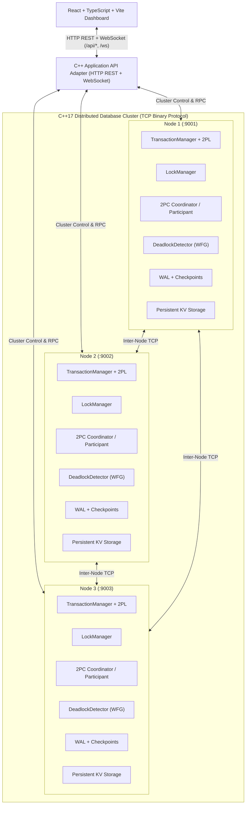

# System Architecture

## 1. Overview

The **Distributed Transactional Key-Value Database Management System** evolves the existing C++17 Distributed Lock Manager (`dlm_core`) into a persistent, sharded, 3-node transactional database with Strict Two-Phase Locking (SS2PL), durable Two-Phase Commit (2PC), Write-Ahead Logging (WAL) with undo/redo crash recovery, global deadlock detection, a C++ HTTP/WebSocket application API adapter, and a real-time React + TypeScript administration dashboard.

> **Replication Scope:** Replication is intentionally excluded in this version. Each key has a single deterministic owning node. If a shard's owning node is unavailable, operations targeting that key fail explicitly as unavailable rather than routing writes elsewhere. Storage and networking interfaces are cleanly decoupled to allow future replication.

---

## 2. High-Level System Architecture

---

## 3. Core Architectural Decisions

### 3.1 Dependency Evaluation
- **`nlohmann/json`:** Single-header C++17 JSON library used for API payloads, JSON key-value validation, configuration loading, and structured WAL/checkpoint serialization where appropriate.
- **HTTP & WebSocket Adapter:** Evaluated Boost.Beast against the local Windows environment (MSVC 2022 without Boost or vcpkg installed). To guarantee zero-friction native Windows builds and lean Docker builds, the application adapter implements a hardened, cross-platform HTTP/1.1 + RFC-6455 WebSocket server directly over Winsock2 (Windows) / POSIX sockets (Linux), keeping the HTTP/WS adapter strictly decoupled from the inter-node TCP protocol.
- **Testing:** GoogleTest (via CMake FetchContent or local test suite) + CTest, preserving and expanding existing tests.

### 3.2 Deterministic Hash-Based Sharding
- Keys are mapped to an owning node using **FNV-1a 64-bit** (a deterministic, platform-independent hash function):
  $$\text{owner\_index} = \text{FNV1a\_64}(\text{key}) \bmod N$$
- Mapped against the sorted list of configured cluster node IDs (e.g., `[1, 2, 3]`).
- Because FNV-1a is deterministic across Windows MSVC, Linux GCC/Clang, and restarts, key ownership is identical across all nodes and client queries.

### 3.3 Globally Unique Transaction Identifiers
- Replaced independent 32-bit per-node counters with a 64-bit globally unique `TxnId`:
  - Upper 16 bits: `NodeId` (originating coordinator node, `1..65535`)
  - Lower 48 bits: monotonically increasing sequence number persisted/seeded above recovered WAL high-water mark so restarts never reuse old `TxnId`s.

### 3.4 Storage, Write Buffering, and Strict 2PL
- **StorageEngine** per node manages `data/node<id>/{database,wal,checkpoints}/`.
- **No Dirty Reads:** Transaction writes (`PUT`, `DELETE`) acquire an `EXCLUSIVE` lock on the owning node and are staged in a per-transaction write buffer (intent/pending write set). Reads (`GET`) acquire a `SHARED` lock on the owning node, checking the transaction's own write buffer first (read-your-own-writes) before reading committed storage.
- **Strict 2PL:** All `SHARED` and `EXCLUSIVE` locks are held until `COMMIT` or `ABORT` completes (including across 2PC `PREPARE`/`PREPARED`).

### 3.5 Two-Phase Commit (2PC) & Blocking Semantics
- **Coordinator:** Logs `PREPARE`, sends `PREPARE` + staged operations to participants, collects `VOTE_YES`/`VOTE_NO` with timeout, **durably flushes** `COMMIT` or `ABORT` decision to WAL before broadcasting `GLOBAL_COMMIT` / `GLOBAL_ABORT`, and retries delivery until acknowledged or recovered.
- **Participant:** Validates locks/writes, writes undo/redo records and `PREPARED` state to durable WAL before voting `VOTE_YES`, retains all locks while `PREPARED`, and applies/undoes changes on `GLOBAL_COMMIT` / `GLOBAL_ABORT`.
- **Blocking Property:** Standard 2PC is a **blocking protocol**—if the coordinator crashes after a participant votes `YES` and persists `PREPARED`, the participant cannot unilaterally commit or abort and must retain locks until the coordinator recovers or an administrator resolves the in-doubt transaction.

### 3.6 Application Backend vs. Database Nodes
- Each database node (`dlm_node`) runs its own StorageEngine, WAL, LockManager, TransactionManager, DeadlockDetector, HeartbeatManager, TwoPCCoordinator, and TCP `NetworkManager`.
- The **Application API Server** (`dlm_api`) acts as the gateway for the React UI and external clients:
  - Communicates with the 3 independent node processes over a control/client TCP RPC channel (and can also run in-process cluster mode for single-binary integration tests).
  - Supports controlled node crash/restart supervision, SQL-like command parsing & execution, authentication, rate limiting, and real-time WebSocket event streaming backed by a full state snapshot endpoint.
