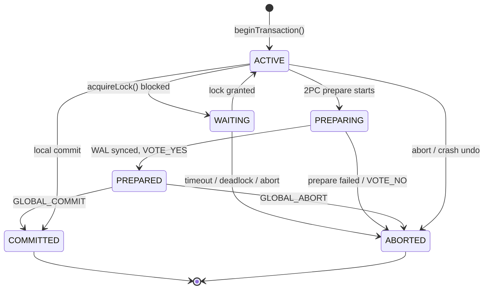

# Transaction Protocol & Lifecycle

## 1. Globally Unique Transaction Identifiers

Every transaction receives a 64-bit globally unique `TxnId` (`include/dlm/common/Types.h`):

$$\text{TxnId} = (\text{OriginNodeId}_{16} \ll 48) \mid \text{Sequence}_{48}$$

- `makeTxnId(originNode, seq)` avoids cross-node ID collisions in distributed WFGs, 2PC, and logs.
- On startup, `TransactionManager::recoverFromWal()` seeds `nextSeq_` above the maximum recovered sequence number for that node.

## 2. Transaction State Machine

Invalid transitions (such as `COMMITTED -> ABORTED`) are rejected by `isValidTxnTransition()`.

## 3. Write Buffering & Isolation

- Uncommitted `PUT` and `DELETE` operations stage changes in `Transaction::writeBuffer_` rather than mutating `StorageEngine`.
- `READ` (`readKey`) acquires a `SHARED` lock and checks `writeBuffer_` first (read-your-own-writes) before reading committed storage.
- `SERIALIZABLE` (Strict 2PL) holds all `SHARED` and `EXCLUSIVE` locks until `COMMITTED` or `ABORTED`.
- `READ_COMMITTED` releases `SHARED` read locks immediately after the read completes while holding `EXCLUSIVE` locks until commit/abort.
- Commit and abort operations are idempotent.
