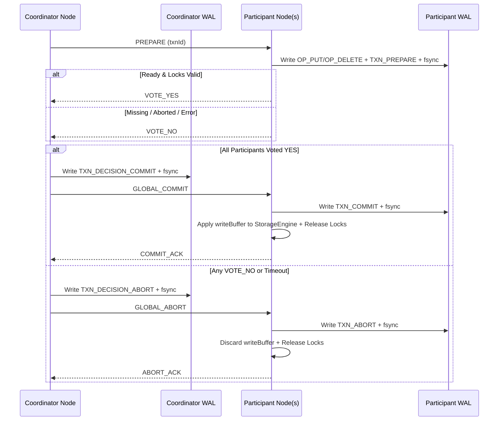

# Two-Phase Commit (2PC) Protocol

## 1. Protocol Flow

## 2. Durability Guarantees & Blocking Property

- **Durable Decision Before Broadcast:** `TwoPCCoordinator::coordinateCommit()` persists `TXN_DECISION_COMMIT` / `TXN_DECISION_ABORT` to both `TransactionLog` and `2pc_decisions.log` with OS-level `FlushFileBuffers` / `fsync` **before** sending Phase-2 messages.
- **Idempotency:** Duplicate `PREPARE`, `GLOBAL_COMMIT`, and `GLOBAL_ABORT` messages are handled safely without double-applying mutations.
- **Blocking Limitation:** Standard 2PC is **blocking**. If the coordinator crashes after a participant persists `TXN_PREPARE` (`PREPARED` state) and votes `VOTE_YES`, the participant retains its locks and does not unilaterally commit or abort until the coordinator recovers and answers `TXN_STATUS_REQ`.
